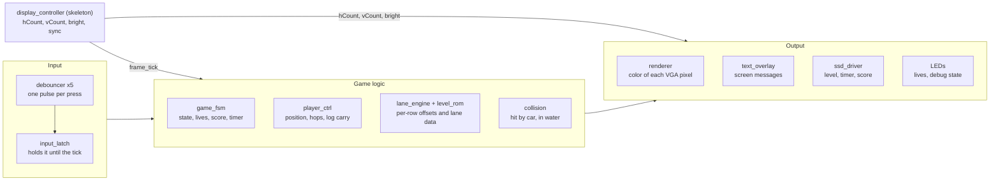
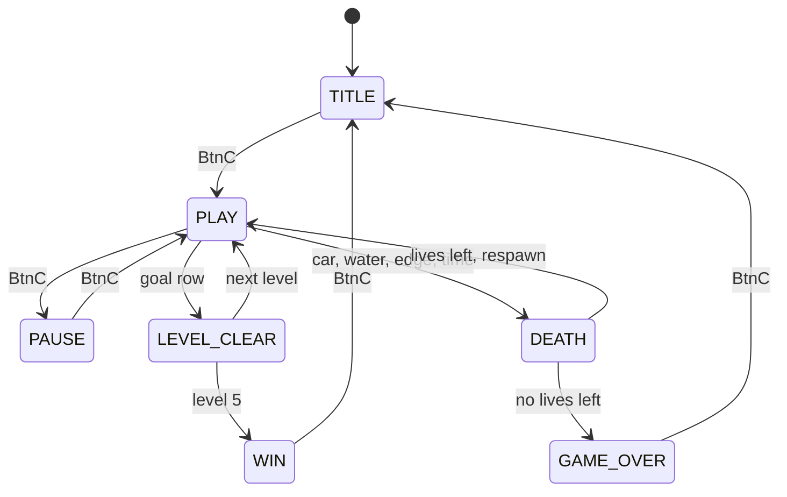

# Crossy Road on FPGA — System Design Document

Nov 24, 2026 · Om Tandon

## 1. Overview and scope

This document specifies a five-level Crossy Road game on the Nexys A7 FPGA, drawn over VGA at 640×480, in enough detail to write every module. It follows the approved proposal by Om Tandon and Ahmed Ataelfadeel.

The player hops a chicken from the bottom row to the goal row at the top. Road lanes carry cars to avoid. River lanes carry logs that must be ridden. Each level adds lanes and speed.

**In scope**

- Five fixed-screen levels, three lives, per-level countdown timer, score
- Seven game states: title, play, pause, death, level clear, game over, win
- VGA output, five push-buttons, eight-digit seven-segment display, LEDs

**Out of scope** (stretch only, section 14): endless scrolling, sprite art, sound, high-score memory.

**Design decisions that shape everything else**

| Decision | Reason |
| --- | --- |
| No framebuffer. Each pixel's color is computed from hCount and vCount as the screen is scanned. | Uses almost no block RAM and matches how the skeleton already draws. |
| A lane is a 20-bit pattern plus a scroll offset. | One lookup answers both "what color is this pixel" and "is the chicken hit". |
| Game logic updates once per frame, on a 60 Hz tick. | Motion is smooth, and every rule can be reasoned about one frame at a time. |
| All game logic runs on the 100 MHz board clock, as the skeleton's own drawing module does. | The skeleton's display controller keeps its 25 MHz clock internal. Leaving it untouched keeps a picture that is known to work. |
| Score and timer are stored as decimal (BCD) digits. | They go straight to the seven-segment display with no binary-to-decimal conversion. |

Numbers marked *tunable* are starting values to adjust during playtesting. Skeleton facts in sections 4, 6, 9 and 10 are taken from the EE354 VGA demo files: `display_controller.v`, `vga_top.v`, `vga_bitchange.v`, `counter.v` and `vga_demo.xdc`.

## 2. Requirements

Each requirement has an ID so tests in section 12 can point back to it.

**Gameplay**

| ID | Requirement |
| --- | --- |
| G-1 | The playfield is a 20×15 grid of 32 px tiles. Row 0 (top) is the goal; row 14 (bottom) is the start. |
| G-2 | One button press moves the chicken exactly one tile. Holding a button does not repeat. |
| G-3 | The chicken cannot leave the screen by hopping. A hop into an edge is ignored. |
| G-4 | Cars and logs move continuously, each lane with its own direction and speed, and wrap around the screen. |
| G-5 | On a river lane the chicken moves sideways with the log under it. |
| G-6 | A life is lost when the chicken overlaps a car, is on a river lane but not on a log, is carried past a screen edge, or the level timer reaches 0. |
| G-7 | After losing a life with lives remaining, the chicken respawns at the start tile and the timer reloads. |
| G-8 | The game starts with 3 lives. At 0 lives the game is over. |
| G-9 | Reaching row 0 clears the level. Clearing level 5 wins the game. |
| G-10 | There are 5 levels. Each has at least as many road and river lanes as the one before, and equal or higher speeds. |
| G-11 | Score: +10 the first time each row is reached in a level, +100 per level cleared. |
| G-12 | BtnC starts the game from the title, toggles pause during play, and returns to the title from the win and game-over screens. |
| G-13 | Pause freezes all motion and the timer. |

**Inputs and outputs**

| ID | Requirement |
| --- | --- |
| IO-1 | Video is 640×480 at 60 Hz on the board's VGA port, 12-bit color. RGB is black outside the visible area. |
| IO-2 | BtnU, BtnD, BtnL, BtnR hop forward, back, left, right. BtnC is start and pause. |
| IO-3 | CPU\_RESET returns to the title screen from any state. |
| IO-4 | The seven-segment display shows the level, the timer in seconds, and the score. |
| IO-5 | LD2–LD0 show lives remaining. LD15–LD9 show the current game state for debugging. |
| IO-6 | Title, pause, level-clear, win and game-over each show a distinct screen. |
| IO-7 | Debug only: SW2–SW0 select the starting level when the game starts. |

**Performance and constraints**

| ID | Requirement |
| --- | --- |
| P-1 | The design meets timing in Vivado with zero failing endpoints. |
| P-2 | Button presses are never missed and never double-counted. |
| P-3 | No visible tearing or flicker: game state changes only during vertical blanking. |
| C-1 | Target is the Nexys A7-100T, written in Verilog, built in Vivado, on top of the EE354 VGA skeleton. |
| C-2 | No block RAM is required for the base game. |
| C-3 | No latches and no combinational loops; synthesis reports none. |

## 3. System architecture

The design is thirteen small modules in three groups: input, game logic, and output. Game logic holds all state; the renderer and the display drivers only read it.



The display controller supplies timing to all three groups. Button presses flow left to right: debounced, latched, consumed by game logic, and shown by the output modules.

| Module | Group | Owner | Job |
| --- | --- | --- | --- |
| `crossy_top` | Top | Both | Replaces the skeleton's `vga_top` and keeps its port names. Pins, reset, `frame_tick`, wiring. |
| `display_controller` | Output | Skeleton | VGA sync signals, `hCount`, `vCount`, `bright`. Used unchanged. |
| `debouncer` ×5 | Input | Om | One clean single-cycle pulse per button press. New: the demo skeleton has none. |
| `input_latch` | Input | Om | Holds each press until the next frame tick consumes it. |
| `game_fsm` | Logic | Ahmed | Game state, level, lives, timer, score. |
| `player_ctrl` | Logic | Ahmed | Chicken position, hops, log carry, furthest row reached. |
| `level_rom` | Logic | Ahmed | Lookup table: (level, row) to lane descriptor. |
| `lane_engine` | Logic | Om | One scroll offset per row, advanced every frame. |
| `lane_lookup` | Shared | Both | Pure function: (descriptor, offset, x) to "object here?". Used by collision and renderer. |
| `collision` | Logic | Ahmed | Decides hit, drowned, on-log from the chicken's position. |
| `renderer` | Output | Om | Color of the current pixel: text, chicken, object, or lane background. Replaces the skeleton's `vga_bitchange`. |
| `text_overlay` | Output | Om | Block-letter messages for title, pause and end screens. |
| `ssd_driver` | Output | Om | Scans eight digits: level, timer, score. Adapted from the skeleton's `counter.v`. |

**Data flow in one frame**

1. During the visible part of the frame, `renderer` reads the frozen game state and colors each pixel.
2. Button pulses arriving at any time are stored by `input_latch`.
3. At the frame tick, in vertical blanking, `collision` is sampled, then `game_fsm`, `player_ctrl` and `lane_engine` all update on the same clock edge.
4. `input_latch` clears. The next frame draws the new state.

**Shared `lane_lookup`.** Collision and drawing ask the same question, so they call the same function. If the chicken dies when it visibly did not touch a car, the bug is in one place.

## 4. Display and coordinate system

Everything on screen is addressed in screen coordinates `x` (0–639) and `y` (0–479), derived once in the renderer from the skeleton's counters.

**From counters to screen coordinates**

`display_controller.v` counts the whole 800×525 VGA frame and registers `bright` one pixel late. As a result `bright` is 1 while `hCount` is 145 to 784 and `vCount` is 35 to 515: 640 pixels wide and 481 lines tall, one line more than the game uses. Define the following, and output black whenever `visible` is 0:

```verilog
wire [9:0] x = hCount - 10'd145;                // 0..639 while bright
wire [9:0] y = vCount - 10'd35;                 // 0..480 while bright
wire       visible = bright && (y < 10'd480);   // drop the 481st line
wire [4:0] col = x[9:5];                        // tile column 0..19
wire [3:0] row = y[8:5];                        // tile row    0..14
wire [4:0] xt  = x[4:0];                        // pixel inside the tile
wire [4:0] yt  = y[4:0];
```

Because tiles are 32 px, tile numbers and in-tile offsets are plain bit slices. No dividers are needed anywhere.

**Colors** (12-bit, `{R,G,B}` 4 bits each)

| Element | Value | Where |
| --- | --- | --- |
| Blanking | `12'h000` | Whenever `bright` is 0. Required, or the monitor loses sync. |
| Grass | `12'h3A3` | Safe rows, including the start row |
| Road | `12'h444` | Road lane background |
| Car | `12'hE22` | Occupied tile on a road lane |
| Water | `12'h24C` | River lane background |
| Log | `12'h852` | Occupied tile on a river lane |
| Goal | `12'hFC0` | Row 0 |
| Chicken | `12'hFFF` | Player; `12'hF00` while in the DEATH state |
| Text | `12'hFFF` | Overlay letters |

**Shapes**

- Cars and logs fill their tiles horizontally but are inset 4 px top and bottom (`yt` from 4 to 27), so lanes read as separate strips.
- The chicken is a 24×24 square: `player_x + 4` to `player_x + 27` horizontally, `yt` from 4 to 27 in its row.

**Draw priority**, highest first: overlay text, chicken, car or log, lane background.

**Screens**

| State | Background | Text |
| --- | --- | --- |
| TITLE | Black | CROSSY / ROAD |
| PLAY | Playfield | None |
| PAUSE | Frozen playfield | PAUSED |
| DEATH | Frozen playfield, chicken red | None |
| LEVEL\_CLEAR | Frozen playfield | LEVEL / CLEAR |
| GAME\_OVER | Dark red `12'h400` | GAME / OVER |
| WIN | Dark green `12'h040` | YOU / WIN |

**Text without a divider.** Letters are 8×8 glyphs drawn at 8× scale, so each character cell is 64×64 px and a line holds 10 characters. The character index is `x[9:6]`, the glyph pixel is `x[5:3]` and `y[5:3]`. Two text lines sit at `y[8:6] == 2` and `y[8:6] == 4`. Only 17 glyphs are needed: A C D E G I L M N O P R S U V W Y, plus space.

If text slips, the background colors alone still tell the five screens apart, which satisfies IO-6.

## 5. Data design

A lane is described by 26 bits, and the whole game state fits in under 250 flip-flops.

**Lane descriptor** (26 bits, one per row, read from `level_rom`)

| Field | Bits | Meaning |
| --- | --- | --- |
| `kind` | 2 | 0 GRASS, 1 ROAD, 2 RIVER, 3 GOAL |
| `dir` | 1 | 0 moves right, 1 moves left |
| `speed` | 3 | Pixels per frame, 0–4 |
| `pattern` | 20 | Bit *i* = 1 means tile *i* holds a car (road) or log (river) before any scrolling |

**Scroll offset.** Each row has a 10-bit `offset` (0–639): how far its pattern has shifted right. Moving left is the same register counting down. Both directions wrap at 640.

**The lookup** used by drawing and collision:

```verilog
// Is there a car/log at screen position px in a lane with this pattern and offset?
function occupied;
  input [19:0] pattern;
  input [9:0]  offset;   // 0..639
  input [9:0]  px;       // 0..639
  reg   [9:0]  u;
  begin
    u = (px >= offset) ? (px - offset) : (px + 10'd640 - offset);
    occupied = pattern[u[9:5]];   // u[9:5] is 0..19
  end
endfunction
```

Put this in a shared include file so `collision` and `renderer` use the identical code.

**Level layouts.** One letter per row, row 0 on the left: Y goal, G grass, R road, W river. Rows not listed in the ROM default to grass, so only the R and W rows need entries.

```
row      0 1 2 3 4 5 6 7 8 9 10 11 12 13 14     roads rivers timer
Level 1  Y G G G G W G G G G R  G  R  G  G        2     1    60 s
Level 2  Y G G W W G G G R R G  R  R  G  G        4     2    60 s
Level 3  Y G W W W W G R R G R  R  R  G  G        5     4    50 s
Level 4  Y G W W W W G R R R G  R  R  R  G        6     4    45 s
Level 5  Y W W W W W G R R R R  R  R  R  G        7     5    40 s
```

**Speeds and directions** (*tunable*)

| Level | Road speed (px/frame) | River speed (px/frame) |
| --- | --- | --- |
| 1 | 1 | 1 |
| 2 | 1 and 2, alternating by row | 1 |
| 3 | 2 | 2 |
| 4 | 2 and 3, alternating by row | 2 |
| 5 | 3 and 4, alternating by row | 3 |

Direction alternates by row: odd rows move right, even rows move left. At 60 frames per second, 1 px/frame crosses the screen in about 10.7 s and 4 px/frame in about 2.7 s.

**Pattern library** (*tunable*). Every river row must contain logs, or it cannot be crossed.

| Name | Value | Contents |
| --- | --- | --- |
| `CAR_A` | `20'h00C03` | Two 2-tile cars, wide gaps |
| `CAR_B` | `20'h00707` | Two 3-tile trucks |
| `CAR_C` | `20'h30C03` | Three 2-tile cars, tighter gaps (levels 4–5) |
| `LOG_A` | `20'h03F3F` | Two 6-tile logs (levels 1–2) |
| `LOG_B` | `20'h0F0F0` | Two 4-tile logs |
| `LOG_C` | `20'h1C387` | Three 3-tile logs (levels 4–5) |

**Level ROM shape**

```verilog
always @(*) begin
  case ({level, row})                      // level 3 bits, row 4 bits
    {3'd1, 4'd0 }: lane = {GOAL,  1'b0, 3'd0, 20'h00000};
    {3'd1, 4'd5 }: lane = {RIVER, 1'b0, 3'd1, LOG_A};
    {3'd1, 4'd10}: lane = {ROAD,  1'b1, 3'd1, CAR_A};
    {3'd1, 4'd12}: lane = {ROAD,  1'b1, 3'd1, CAR_B};
    // ... levels 2 to 5 ...
    default:       lane = {GRASS, 1'b0, 3'd0, 20'h00000};
  endcase
end
```

**State registers**

| Register | Bits | Range | Owner module |
| --- | --- | --- | --- |
| `state` | 3 | 7 states | `game_fsm` |
| `level` | 3 | 1–5 | `game_fsm` |
| `lives` | 2 | 0–3 | `game_fsm` |
| `score_th`, `score_h`, `score_t` | 4 each | BCD digits; the ones digit is always 0 | `game_fsm` |
| `timer_tens`, `timer_ones` | 4 each | BCD seconds | `game_fsm` |
| `frame_cnt` | 6 | 0–59, one second | `game_fsm` |
| `hold_cnt` | 7 | Frames left in DEATH or LEVEL\_CLEAR | `game_fsm` |
| `player_x` | 10 | 0–608, in pixels | `player_ctrl` |
| `player_row` | 4 | 0–14 | `player_ctrl` |
| `best_row` | 4 | Lowest row number reached this level | `player_ctrl` |
| `offset[0..14]` | 10 each | 0–639 | `lane_engine` |

`player_x` is in pixels, not tiles, because a log carries the chicken a few pixels per frame. The highest possible score is 1,200, so four digits are enough.

## 6. Module specifications

These port lists are the contract between the two halves of the team. Agree on them first; after that each module can be written and simulated alone. Every module also takes `clk`, which is `ClkPort` at 100 MHz, and a synchronous, active-high `reset`.

**Shared signals**

| Signal | Width | Driven by | Meaning |
| --- | --- | --- | --- |
| `frame_tick` | 1 | `crossy_top` | High for exactly one clock cycle per frame, in vertical blanking |
| `play_tick` | 1 | `game_fsm` | `frame_tick` while in PLAY. The only enable for motion. |
| `respawn` | 1 | `game_fsm` | Pulse: put the chicken back on the start tile |
| `level_load` | 1 | `game_fsm` | Pulse: new level. Clear offsets and `best_row`. |
| `state`, `level`, `lives` | 3, 3, 2 | `game_fsm` | Current game status |
| `player_x`, `player_row` | 10, 4 | `player_ctrl` | Chicken position |
| `lane_r`, `off_r` | 26, 10 | `lane_engine` | Descriptor and offset of the row being drawn |
| `lane_p`, `off_p` | 26, 10 | `lane_engine` | Descriptor and offset of the chicken's row |

### crossy\_top

Replaces the skeleton's `vga_top`. It keeps that module's port names, so the lines already active in `vga_demo.xdc` still apply, and adds the extra buttons, switches, LEDs and reset.

```verilog
module crossy_top(
  input  ClkPort,                       // 100 MHz
  input  CPU_RESETN,                    // active low
  input  BtnC, BtnU, BtnD, BtnL, BtnR,
  input  Sw0, Sw1, Sw2,
  output hSync, vSync,
  output [3:0] vgaR, vgaG, vgaB,
  output An0, An1, An2, An3, An4, An5, An6, An7,
  output Ca, Cb, Cc, Cd, Ce, Cf, Cg, Dp,
  output Ld0, Ld1, Ld2,
  output LD9, LD10, LD11, LD12, LD13, LD14, LD15,
  output QuadSpiFlashCS                 // held at 1, as in vga_top
);
```

It instantiates `display_controller` exactly as `vga_top` does, clocked by `ClkPort`, and creates `reset` and `frame_tick`:

```verilog
// synchronized, active-high reset
reg r0, r1;
always @(posedge ClkPort) begin r0 <= ~CPU_RESETN; r1 <= r0; end
wire reset = r1;

// vCount 516..524 is vertical blanking. hCount and vCount hold each value
// for four ClkPort cycles, so detect the edge to get a one-cycle tick.
reg vb0, vb1, vb2;
always @(posedge ClkPort) begin
  vb0 <= (vCount >= 10'd516);
  vb1 <= vb0;
  vb2 <= vb1;
end
wire frame_tick = vb1 & ~vb2;
```

The remaining top-level assignments follow `vga_top`: `{vgaR, vgaG, vgaB} = rgb`, `Dp = 1`, `QuadSpiFlashCS = 1`.

### debouncer

The demo skeleton has no debouncer; its `vga_bitchange` reads `BtnU` raw. Use one instance of this module per button. If you have `ee354_debouncer.v` from an earlier lab, its single-pulse output can stand in for it.

```verilog
module debouncer(
  input  clk, reset,
  input  btn,                // raw, asynchronous, active high
  output reg pulse           // one clk cycle per accepted press
);
  reg        s0, s1;         // two-flip-flop synchronizer
  reg        stable;         // debounced level
  reg [20:0] cnt;            // 2^21 cycles at 100 MHz is about 21 ms

  always @(posedge clk) begin
    s0    <= btn;
    s1    <= s0;
    pulse <= 1'b0;
    if (reset) begin
      stable <= 1'b0;
      cnt    <= 21'd0;
    end else if (s1 == stable) begin
      cnt <= 21'd0;                       // no change pending
    end else begin
      cnt <= cnt + 21'd1;
      if (&cnt) begin                     // different for 21 ms: accept
        stable <= s1;
        pulse  <= s1;                     // pulse on press, not on release
        cnt    <= 21'd0;
      end
    end
  end
endmodule
```

### input\_latch

```verilog
input  pulse_u, pulse_d, pulse_l, pulse_r, pulse_c;  // from debouncers (single-cycle)
input  frame_tick;
output reg req_u, req_d, req_l, req_r, req_c;       // held until consumed
```

A pulse sets its request bit. `frame_tick` clears all five. If both happen in the same cycle, set wins, so no press is lost.

### game\_fsm

```verilog
input        frame_tick, req_c;
input        hit_car, in_water, carried_off;   // from collision / player_ctrl
input        at_goal, new_row;                 // from player_ctrl
input  [2:0] sw_level;                         // SW[2:0], debug start level
output [2:0] state, level;
output [1:0] lives;
output       play_tick, respawn, level_load;
output [3:0] score_th, score_h, score_t;       // BCD
output [3:0] timer_tens, timer_ones;           // BCD seconds
```

Behavior is defined in section 7. Scoring and the timer are in section 8.

### player\_ctrl

```verilog
input        play_tick, respawn, level_load;
input        req_u, req_d, req_l, req_r;
input [25:0] lane_p;                 // lane under the chicken
output reg [9:0] player_x;           // 0..608
output reg [3:0] player_row;         // 0..14
output       at_goal;                // player_row == 0
output       new_row;                // pulse: first time on this row this level
output       carried_off;            // log would push the chicken past an edge
```

### lane\_engine

```verilog
input        play_tick, level_load;
input  [2:0] level;
input  [3:0] row_r, row_p;           // row being drawn, chicken's row
output [25:0] lane_r, lane_p;
output [9:0]  off_r,  off_p;
```

Contains 15 `level_rom` instances in a generate loop, one per row with a constant row input, and 15 offset registers. Synthesis reduces each ROM instance to a few gates. A query for row 15, the unused 481st line, returns grass with offset 0. `lane_p` and `off_p` are registered on the way out to shorten the path into `collision`; they only change at a frame tick, so the one-cycle delay has no effect.

### level\_rom

```verilog
input  [2:0]  level;
input  [3:0]  row;
output reg [25:0] lane;              // {kind, dir, speed, pattern}
```

Purely combinational. See section 5.

### collision

```verilog
input  [25:0] lane_p;
input  [9:0]  off_p, player_x;
output reg    hit_car, in_water;     // registered
```

The rule in section 8.3 is combinational, and its two results are registered once. The inputs change only at a frame tick and `game_fsm` samples the results at the next one, 16.7 ms later, so the extra cycle is invisible.

### renderer

```verilog
input        bright;
input  [9:0] hCount, vCount;
input  [2:0] state;
input [25:0] lane_r;
input  [9:0] off_r, player_x;
input  [3:0] player_row;
input        text_on;                // from text_overlay
output [3:0] row_r;                  // y[8:5], to lane_engine
output [9:0] x, y;                   // screen coordinates, to text_overlay
output reg [11:0] rgb;               // {R,G,B}; combinational, as in vga_bitchange
```

### text\_overlay

```verilog
input  [9:0] x, y;
input  [2:0] state;
output       text_on;                // this pixel is part of a letter
```

Two small ROMs: message (state, line, character index) to glyph number, and glyph (number, row) to 8 pixel bits.

### ssd\_driver

```verilog
input  [2:0] level;
input  [3:0] timer_tens, timer_ones, score_th, score_h, score_t;
output reg [7:0] an;                 // {An7..An0}, active low
output reg [6:0] seg;                // {Ca,Cb,Cc,Cd,Ce,Cf,Cg}, active low
```

Digit layout, left to right (`An7` to `An0`): `L`, level, timer tens, timer ones, score thousands, hundreds, tens, `0`.

Start from the skeleton's `counter.v`, keep its digit-to-segment table, and make three changes:

- Scan eight digits with `refresh[19:17]` instead of four with `refresh[20:19]`. Each digit is lit for about 1.3 ms and the whole display refreshes about 95 times a second.
- Feed the BCD digits straight in. This removes the `/` and `%` operators, which synthesize into dividers.
- Add the letter L as `7'b1110001` and drive all eight anodes; `vga_top` currently forces `An7` to `An4` off.

## 7. Game state machine

The game has seven states, and every transition except reset happens at a frame tick. This is the proposal's state diagram with two details added: DEATH and LEVEL\_CLEAR hold for a fixed time before moving on.



PLAY leaves in three ways: pause, death, or level clear. Death and level clear return to PLAY until lives or levels run out; the two end states return to TITLE on BtnC.

**Transitions**

| From | To | Condition | Actions on the transition |
| --- | --- | --- | --- |
| Any | TITLE | `reset` | Clear everything |
| TITLE | PLAY | `req_c` | `level` = SW\[2:0\] if 1–5, else 1. `lives` = 3. Score = 0. `level_load`, `respawn`, load timer. |
| PLAY | LEVEL\_CLEAR | `at_goal` | Score +100. `hold_cnt` = 120. |
| PLAY | DEATH | `hit_car`, `in_water`, `carried_off`, or timer = 0 | `lives` − 1. `hold_cnt` = 60. |
| PLAY | PAUSE | `req_c` | None |
| PAUSE | PLAY | `req_c` | None |
| DEATH | PLAY | `hold_cnt` = 0 and `lives` > 0 | `respawn`, reload timer |
| DEATH | GAME\_OVER | `hold_cnt` = 0 and `lives` = 0 | None |
| LEVEL\_CLEAR | PLAY | `hold_cnt` = 0 and `level` < 5 | `level` + 1. `level_load`, `respawn`, load the new level's timer. |
| LEVEL\_CLEAR | WIN | `hold_cnt` = 0 and `level` = 5 | None |
| GAME\_OVER | TITLE | `req_c` | None |
| WIN | TITLE | `req_c` | None |

**Priority inside PLAY** when several conditions are true on the same tick: goal first, then death, then pause. A chicken that reaches the goal on the tick the timer expires clears the level.

**Encoding and debug LEDs**

| State | Code | LED lit |
| --- | --- | --- |
| TITLE | 0 | LD15 |
| PLAY | 1 | LD14 |
| PAUSE | 2 | LD13 |
| DEATH | 3 | LD12 |
| LEVEL\_CLEAR | 4 | LD11 |
| GAME\_OVER | 5 | LD10 |
| WIN | 6 | LD9 |

**Hold counters.** `hold_cnt` counts down one per frame: 60 frames is 1 s, 120 frames is 2 s (*tunable*). Because `lives` is decremented on entry to DEATH, the exit test sees the already-reduced value.

## 8. Core processes

Six small processes make up the game. Each runs on `play_tick`, so everything moves together and nothing moves while paused. The code below is a reference sketch, not tested RTL.

In all snippets: `kind = lane[25:24]`, `dir = lane[23]`, `speed = lane[22:20]`, `pattern = lane[19:0]`.

### 8.1 Lane scrolling (`lane_engine`)

```verilog
// for each row r
if (reset || level_load)   offset[r] <= 10'd0;
else if (play_tick) begin
  if (!dir) offset[r] <= (offset[r] + speed >= 10'd640) ? offset[r] + speed - 10'd640
                                                         : offset[r] + speed;
  else      offset[r] <= (offset[r] < speed)            ? offset[r] + 10'd640 - speed
                                                         : offset[r] - speed;
end
```

### 8.2 Chicken movement (`player_ctrl`)

One action per frame, in priority order: hop, else ride the log, else snap to the tile grid.

```verilog
wire on_river = (kind == RIVER);
wire [9:0] snapped = {player_x[9:5] + player_x[4], 5'd0};   // nearest tile
assign carried_off = on_river &&
                     (dir ? (player_x < speed) : (player_x + speed > 10'd608));

always @(posedge clk) begin
  if (reset || respawn) begin
    player_x <= 10'd320;  player_row <= 4'd14;              // start tile
  end else if (play_tick) begin
    if      (req_u && player_row != 4'd0)   player_row <= player_row - 4'd1;
    else if (req_d && player_row != 4'd14)  player_row <= player_row + 4'd1;
    else if (req_l && player_x >= 10'd32)   player_x   <= player_x - 10'd32;
    else if (req_r && player_x <= 10'd576)  player_x   <= player_x + 10'd32;
    else if (on_river && !carried_off)      player_x   <= dir ? player_x - speed
                                                             : player_x + speed;
    else if (!on_river)                     player_x   <= snapped;
  end
end
```

- The chicken and its log move by the same amount on the same tick, so the chicken stays fixed on the log.
- After stepping off a log onto grass or road, the chicken snaps to the nearest tile on the next frame, a shift of at most 16 px.
- `best_row` resets to 14 on `level_load`. `new_row` is high when a forward hop lands on a row above `best_row`, which is then updated.

### 8.3 Collision (`collision`)

Three sample points on the chicken's row: left edge, right edge, and center of its 24 px body.

```verilog
wire left   = occupied(pattern, off_p, player_x + 10'd4);
wire right  = occupied(pattern, off_p, player_x + 10'd27);
wire center = occupied(pattern, off_p, player_x + 10'd16);

assign hit_car  = (kind == ROAD)  && (left || right);
assign in_water = (kind == RIVER) && !center;
```

Cars kill on any overlap. Logs only need to be under the chicken's center, which is forgiving in the way players expect.

### 8.4 Pixel color (`renderer`)

```verilog
wire band    = (yt >= 5'd4) && (yt <= 5'd27);
wire obj     = band && occupied(pattern_r, off_r, x);      // car or log
wire chicken = band && (row == player_row) &&
               (x >= player_x + 10'd4) && (x <= player_x + 10'd27);

always @(*) begin                       // combinational, like vga_bitchange
  if      (!visible)           rgb = 12'h000;
  else if (text_on)            rgb = 12'hFFF;
  else if (state == TITLE)     rgb = 12'h000;
  else if (state == GAME_OVER) rgb = 12'h400;
  else if (state == WIN)       rgb = 12'h040;
  else if (chicken)            rgb = (state == DEATH) ? 12'hF00 : 12'hFFF;
  else if (obj)                rgb = (kind_r == ROAD) ? 12'hE22 : 12'h852;
  else case (kind_r)
    GRASS:   rgb = 12'h3A3;
    ROAD:    rgb = 12'h444;
    RIVER:   rgb = 12'h24C;
    default: rgb = 12'hFC0;             // GOAL
  endcase
end
```

Grass and goal rows have an all-zero pattern, so `obj` is never true there.

### 8.5 Timer (`game_fsm`)

- `frame_cnt` counts `play_tick`s from 0 to 59. On wrapping, the two-digit BCD timer decrements by one second.
- The timer loads the level's value (60, 60, 50, 45, 40 s) on level start and on respawn.
- Timer at 00 in PLAY causes a death.

### 8.6 Score (`game_fsm`)

- `new_row` adds 10: increment `score_t`; on 9 it wraps to 0 and carries into `score_h`, and so on.
- Entering LEVEL\_CLEAR adds 100: increment `score_h` with the same carry.
- Rows only score once per level, even across deaths, so hopping back and forth earns nothing.

## 9. Clocking, reset and timing

All game logic runs on `ClkPort`, the 100 MHz board clock. `display_controller` stays unchanged and is the only module with a clock of its own. This is the same arrangement the skeleton's `vga_bitchange` uses.

**Clock**

- `display_controller` divides `ClkPort` by four into an internal 25 MHz clock that drives `hCount`, `vCount` and `bright`. It does not output that clock, so no other module can use it.
- `hCount` and `vCount` therefore hold each value for four `ClkPort` cycles. Any condition written on them is true for at least four cycles. Never use one directly as an enable; `frame_tick` is edge-detected for this reason (section 6).
- Game state never depends on `hCount` or `vCount` except through `frame_tick`. Only the renderer and text overlay read them, and their output is combinational, as in the skeleton.
- Debouncers, `input_latch` and all game modules share `ClkPort`, so a single-cycle pulse from one is always seen by the next (P-2).
- Create no other clocks. Use `frame_tick` and `play_tick` as enables, never as clocks.
- `vga_demo.xdc` already constrains `ClkPort` to 10 ns. Vivado's timing report may list the counters inside `display_controller` as having no clock; that comes from the skeleton's divided clock and is expected.

**Reset**

- `CPU_RESETN` (pin C12) is active low and is commented out in `vga_demo.xdc`. Uncomment it and add it to the top-level ports.
- It is asynchronous. `crossy_top` inverts it and passes it through two flip-flops; every module then uses it as a synchronous reset.
- The skeleton sets start-up values with `initial` blocks and has no reset. New modules use the reset instead, which is what makes IO-3 work.

**Asynchronous inputs**

- Buttons are asynchronous and bounce. Each goes through a `debouncer` (section 6), which synchronizes it, waits about 21 ms for it to settle, and emits one pulse per press.
- `Sw2` to `Sw0` are read only on the TITLE to PLAY transition. Pass them through two flip-flops first.

**When state may change**

- All game state changes at `frame_tick`, which falls in vertical blanking. The renderer therefore sees one consistent state for the whole visible frame (P-3).
- The one exception is `input_latch`, which captures presses at any time.

**Timing budget**

- The budget is 10 ns between registers.
- The longest logic chain is row select, level ROM, lookup subtract, 20-way select, then the state machine. Two register stages break it up: `lane_engine` registers `lane_p` and `off_p`, and `collision` registers its outputs. Their inputs change only at a frame tick, so a delay of a few cycles is invisible.
- The renderer is combinational from the counters to the VGA pins and is not part of any register-to-register path. Each pixel lasts 40 ns; brief glitches at pixel boundaries are invisible, as they are in the skeleton.
- If timing still fails, open the failing path in the timing report and add a register there. Do not demo a bitstream with failing endpoints.

## 10. Board I/O and pin mapping

The design uses the clock, reset, five buttons, three switches, ten LEDs, the eight-digit display and the VGA port. All pins are LVCMOS33.

Pin numbers below match `vga_demo.xdc`, the constraints file shipped with the skeleton, which targets the Nexys A7-100T. Copy that file to `constr/crossy.xdc` and uncomment the lines for the ports the demo does not use:

- `CPU_RESETN`
- `BtnL`, `BtnR`, `BtnD`
- `Sw0`, `Sw1`, `Sw2`
- `Ld0`, `Ld1`, `Ld2`
- `LD9` to `LD15`. The file spells these in capitals, unlike `Ld0` to `Ld7`. Port names in `crossy_top` must match the file exactly.

The clock, `BtnC`, `BtnU`, the seven-segment display, the VGA pins and `QuadSpiFlashCS` are already active in the file.

| Function | Signal | Pin(s) | Notes |
| --- | --- | --- | --- |
| Clock | `ClkPort` | E3 | 100 MHz |
| Reset | `CPU_RESETN` | C12 | Active low |
| Hop forward | `BtnU` | M18 | Active high |
| Hop back | `BtnD` | P18 |  |
| Hop left | `BtnL` | P17 |  |
| Hop right | `BtnR` | M17 |  |
| Start / pause | `BtnC` | N17 |  |
| Start level (debug) | `Sw2`, `Sw1`, `Sw0` | M13, L16, J15 |  |
| Lives | `Ld2`, `Ld1`, `Ld0` | J13, K15, H17 | 3 lit = 3 lives |
| State (debug) | `LD15` … `LD9` | V11, V12, V14, V15, T16, U14, T15 | One-hot, see section 7 |
| VGA red | `vgaR[3:0]` | A4, C5, B4, A3 | Bit 3 first |
| VGA green | `vgaG[3:0]` | A6, B6, A5, C6 |  |
| VGA blue | `vgaB[3:0]` | D8, D7, C7, B7 |  |
| VGA sync | `hSync`, `vSync` | B11, B12 |  |
| Display segments | `Ca` … `Cg`, `Dp` | T10, R10, K16, K13, P15, T11, L18, H15 | Active low |
| Display digits | `An7` … `An0` | U13, K2, T14, P14, J14, T9, J18, J17 | Active low |

**Lives on LEDs:** `Ld0 = lives >= 1`, `Ld1 = lives >= 2`, `Ld2 = lives == 3`.

**Fixed outputs.** `QuadSpiFlashCS` (pin L13) is held at 1 to keep the on-board flash memory disabled, exactly as `vga_top` does. `Dp` is held at 1, which is off.

**Monitor.** The board outputs analog VGA only. A monitor without a VGA input needs an active VGA-to-HDMI converter.

## 11. Build process

Keep source files in one shared git repository and build in Vivado; never commit Vivado's generated project folders.

**Repository layout**

```
crossy-road/
  DESIGN.md                   (this document)
  skeleton/                   (reference only, not built)
    vga_top.v
    vga_bitchange.v
    counter.v
    vga_demo.xdc
  src/
    crossy_top.v              (replaces vga_top.v)
    display_controller.v      (skeleton, unchanged)
    debouncer.v
    input_latch.v
    game_fsm.v
    player_ctrl.v
    lane_engine.v
    level_rom.v
    collision.v
    renderer.v                (replaces vga_bitchange.v)
    text_overlay.v
    ssd_driver.v              (adapted from counter.v)
    crossy_defs.vh            (shared constants + occupied function)
  sim/
    tb_lane_lookup.v
    tb_player_ctrl.v
    tb_collision.v
    tb_game_fsm.v
    tb_score_timer.v
    tb_top.v
  constr/
    crossy.xdc                (vga_demo.xdc with the extra pins uncommented)
  README.md
```

**Shared definitions (`crossy_defs.vh`)**

State codes, lane kinds, colors, pattern library, and the `occupied` function live here and are included by every module that needs them. A constant defined in two files will eventually disagree with itself.

**Vivado flow**

1. Create an RTL project for part `xc7a100tcsg324-1`, the Nexys A7-100T that `vga_demo.xdc` targets. Add `src/` as design sources, `sim/` as simulation sources, `constr/` as constraints. Do not copy files into the project.
2. Set `crossy_top` as the top module.
3. Run behavioral simulation for the testbench of the module you changed.
4. Run synthesis. Read the messages: fix every inferred latch, multi-driven net and width-mismatch warning.
5. Run implementation. Open the timing summary and confirm no failing endpoints (P-1).
6. Generate the bitstream and program the board through Hardware Manager.

**Coding rules**

- Sequential logic: `always @(posedge clk)` with non-blocking `<=` only.
- Combinational logic: `always @(*)` with blocking `=` only, and a default assignment for every output at the top of the block. This is what prevents latches (C-3).
- Every `case` has a `default`.
- Put a width on every constant: `10'd640`, not `640`.
- One module per file, file name equal to module name.
- A register is written in exactly one `always` block.
- Start each file with `` `default_nettype none `` so a misspelled signal name is an error instead of a silent 1-bit wire, and end it with `` `default_nettype wire `` so the setting does not leak into the skeleton files.

The skeleton files use `initial` blocks for start-up values and blocking assignments inside clocked blocks. Leave `display_controller.v` exactly as it is, but do not copy that style into new modules.

**Working together**

- Each person works on a branch and merges only code that synthesizes.
- Port lists in section 6 change only by agreement, and this document is updated in the same commit.
- Keep a `known-good` tag on the last bitstream that worked on the board. Before the demo, that is the fallback.

## 12. Verification and test plan

Test in three layers: simulate each logic module alone, simulate the game with the frame tick sped up, then run the acceptance checklist on the board.

**Simulation speed-up.** A real frame is 420,000 pixels, or 1.68 million cycles of the 100 MHz clock, so simulating real frames is slow. Testbenches for logic modules drive `frame_tick` directly, one pulse every few clocks. Only `tb_top` uses the real display controller, and only for a frame or two.

**Unit tests**

| Testbench | What it proves | Key cases |
| --- | --- | --- |
| `tb_lane_lookup` | `occupied` and offset wrap are right | Offset 0, 31, 32, 639; pattern bits 0 and 19; left and right motion across the wrap point |
| `tb_player_ctrl` | Hops, edges, log carry, snap | Hop at all four edges is ignored; carry left and right; `carried_off` at x = 0 and 608; snap from x = 47 gives 32, from 48 gives 64 |
| `tb_collision` | Hit and water rules | Car touching only the left sample point; only the right; chicken centered on a log end; just off a log end |
| `tb_game_fsm` | Every row of the transition table | Each transition once; goal and death on the same tick; third death goes to GAME\_OVER; level 5 clear goes to WIN |
| `tb_score_timer` | BCD arithmetic | Score carry 90 to 100 and 990 to 1000; timer borrow 10 to 09; timer 00 causes death |
| `tb_top` | The pieces connect | After reset, `hSync` and `vSync` toggle; RGB is 0 whenever `bright` is 0; no X or Z on any output |

Make testbenches self-checking: compare against expected values and print PASS or FAIL, so a regression is caught without reading waveforms.

**Board bring-up order.** Each step adds one thing, so a failure points at the last thing added.

1. Unmodified skeleton displays on your monitor.
2. Static level 1 background: correct row colors, 15 rows, no flicker.
3. Chicken square appears on the start tile and hops with all four buttons.
4. Lanes scroll; cars and logs wrap cleanly with no jump at the screen edge.
5. Collisions and log riding; state LEDs show DEATH.
6. Lives, respawn, score and timer on the display.
7. All five levels, using SW2–SW0 to jump to each.
8. Text screens.

**Acceptance checklist** (run before the demo; every line must pass)

| Check | Requirement |
| --- | --- |
| Picture is stable and fills the screen, no flicker or tearing | IO-1, P-3 |
| Tap each direction 20 times: exactly 20 hops, none missed, none doubled | G-2, P-2 |
| Holding a direction gives one hop | G-2 |
| Hopping into each of the four edges does nothing | G-3 |
| Touching a car costs one life; narrowly missing one does not | G-6 |
| Stepping into water costs one life | G-6 |
| Riding a log carries the chicken; riding it off either edge costs one life | G-5, G-6 |
| Letting the timer run out costs one life | G-6 |
| After a death the chicken is on the start tile and the timer is full | G-7 |
| Third death shows GAME OVER; BtnC returns to the title | G-8, G-12 |
| Reaching the top shows LEVEL CLEAR, then the next level loads | G-9 |
| Each level is visibly busier or faster than the last | G-10 |
| Clearing level 5 shows YOU WIN | G-9 |
| Score rises by 10 per new row and 100 per level; hopping back and forward adds nothing | G-11 |
| Pause freezes cars, logs and timer; unpausing resumes exactly | G-13 |
| CPU\_RESET returns to the title from every state | IO-3 |
| Display shows level, timer, score; LEDs show lives | IO-4, IO-5 |
| Vivado timing summary shows no failing endpoints; synthesis shows no latches | P-1, C-3 |
| Level 5 can be cleared by a person in a few attempts | Playability |

## 13. Build order, schedule and task split

Build in ten milestones, each ending with something visible on the board. Milestones 1 to 8 are a complete game; 9 and 10 are polish.

| # | Milestone | Owner | Needs | Done when |
| --- | --- | --- | --- | --- |
| 1 | Foundations: `crossy_defs.vh`, top-level wiring, `frame_tick`, synchronized reset | Both | Skeleton | Skeleton picture still shows; `frame_tick` pulses once per frame in simulation |
| 2 | Static background: `renderer` and `level_rom` for level 1 | Om | 1 | 15 correctly colored rows on screen |
| 3 | Hopping: `input_latch`, `player_ctrl` without logs | Ahmed, Om | 1 | White square hops one tile per press and stops at edges |
| 4 | Scrolling: `lane_engine`, objects drawn | Om | 2 | Cars and logs move and wrap cleanly |
| 5 | Collision and log riding | Ahmed | 3, 4 | Debug LEDs show hit and water correctly; chicken rides logs |
| 6 | State machine, lives, respawn | Ahmed | 5 | Full loop: title, play, three deaths, game over, back to title |
| 7 | Score, timer, display, LEDs | Ahmed, Om | 6 | Numbers on the display match play |
| 8 | All five levels | Ahmed | 6 | Every level reachable and clearable |
| 9 | Text screens | Om | 6 | Each state shows its message |
| 10 | Tuning and acceptance checklist | Both | 8 | Every line in section 12 passes |

Milestones 2 and 3 can run in parallel, as can 7, 8 and 9.

**Against the calendar**

| Date | Proposal plan | Milestones |
| --- | --- | --- |
| Week of Nov 9 | Skeleton, debouncing, hopping, static lanes, basic state machine | 1–3 |
| Week of Nov 16 | Moving lanes, collision, logs, lives, score and LEDs | 4–7 |
| Week of Nov 23 | Five levels, timer, screens | 8–9 |
| Nov 30 – Dec 4 | Testing and tuning, lab demo, final report due Dec 4 | 10 |

**If time runs short, cut in this order:** text screens (fall back to background colors), then pause, then the level timer, then levels 4 and 5. Do not cut collision correctness or input reliability; those are what a grader notices in the first ten seconds.

**Task split** (from the proposal)

- **Ahmed, game logic:** `game_fsm`, `player_ctrl`, `collision`, `level_rom`, scoring and level settings.
- **Om, display and I/O:** `renderer`, `lane_engine`, `text_overlay`, `ssd_driver`, `input_latch`, LEDs.
- **Both:** `crossy_top`, `crossy_defs.vh`, integration, board testing, demo, final report.

## 14. Risks, pitfalls and stretch goals

The likeliest failures are integration bugs, not hard algorithms, and each has a known symptom.

**Pitfalls by symptom**

| Symptom | Likely cause | Fix |
| --- | --- | --- |
| Monitor shows "no signal" or "out of range" | RGB not black during blanking, or sync signals changed | Force `12'h000` when `bright` is 0; leave the skeleton's sync logic alone |
| Picture shifted or cut off | Wrong visible-window offsets | Use the 145 and 35 from section 4, which come from `display_controller.v` |
| Button sometimes ignored | Pulse made on a faster clock than the logic reading it | One clock everywhere (section 9); `input_latch` |
| One press gives two hops | Raw button used instead of the debounced single pulse | Use only the debouncer's single-cycle output |
| Objects tear or shimmer | Game state changing mid-frame | Update only on `frame_tick` |
| Objects jump at the wrap point | Offset wraps at 1024 instead of 640 | Use the explicit compare-and-correct in 8.1 |
| Chicken dies next to a car, not on it | Collision and renderer use different lookups | Both call the shared `occupied` |
| Chicken slides off a log by itself | Carry and scroll use different speeds or ticks | Both read the same `lane_p` on the same `play_tick` |
| Works in simulation, random on the board | Latch, unsynchronized input, or failed timing | Read synthesis warnings and the timing summary |
| Digits ghost or look dim | Display scan too fast or too slow | Aim for 500 Hz to 1 kHz per digit |

**Risks**

| Risk | Effect | Mitigation |
| --- | --- | --- |
| Thanksgiving week absorbs milestones 8 and 9 | No time left to tune | The cut order in section 13; a tagged known-good bitstream |
| Level 5 is unbeatable at the demo | Cannot show the win screen | SW2–SW0 start-level select; tune speeds on real hardware early |
| VGA converter rejects 640×480 | No picture on an HDMI monitor | Test the exact demo setup days ahead; lab VGA monitors as backup |
| Your skeleton files differ from the November 2024 versions used here | Offsets, clocking or pins are wrong | Compare your copies against sections 4, 9 and 10 before building on them |

**Open questions**

- [ ] Does the TA require switches to be used as game controls, or is the debug start-level select enough?
- [ ] Will the demo monitor take VGA directly, or is the HDMI converter needed?

**Stretch goals**, each independent of the others and added only after milestone 10:

- Pixel-art sprites for the chicken, cars and logs (notes below)
- Sound on the mono audio output: hop, crash and level-clear tones
- Endless mode with lanes generated by an LFSR
- Train lanes with a warning light, and a best score kept until reset

**Sprite notes** for `ee354_optimized_sprite_script.py`, if you take that stretch goal:

- It needs the `imageio` package and writes a module named `<image>_rom` with inputs `clk`, `row`, `col` and a 12-bit `color_data` output in the same `{R,G,B}` order the renderer uses.
- The module registers `row` and `col`, so the color arrives one clock late. At 100 MHz that is a quarter of a pixel and needs no correction.
- Use 32×32 PNG images, one tile each. Its address-width formula is wrong for some sizes that are not a power of two, and unused addresses would infer latches. JPEG compression noise defeats the script's grouping of same-colored runs.
- As shipped, its last line always converts `flappyBird.jpg`. Change that line to your image.
- Leave masking off. That branch calls a function the script never defines.
- For transparency, paint the sprite background one key color such as `12'hF0F`, and have the renderer fall through to the lane color when the ROM returns it.
- The output is a chain of comparisons, not a true memory. A few 32×32 sprites are fine; large images are not.
